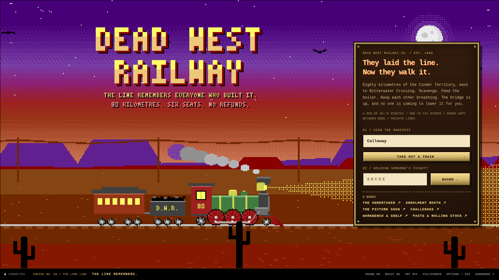
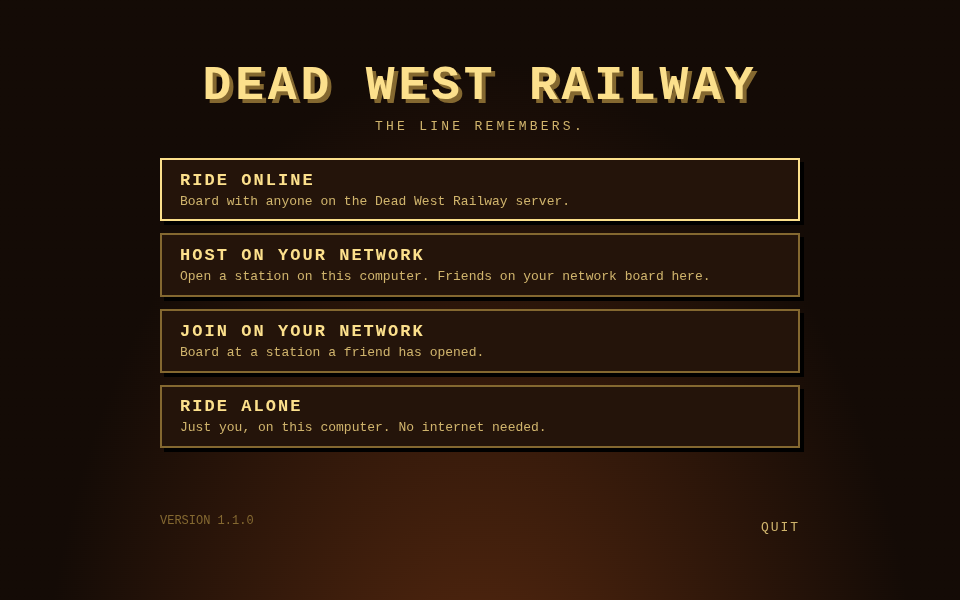
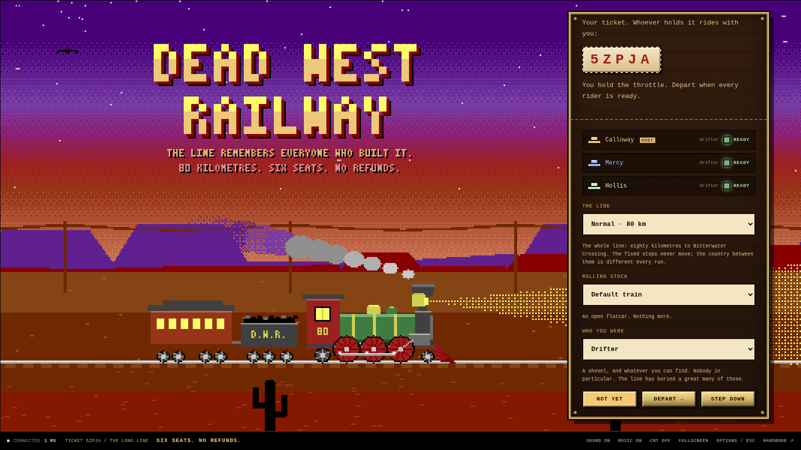
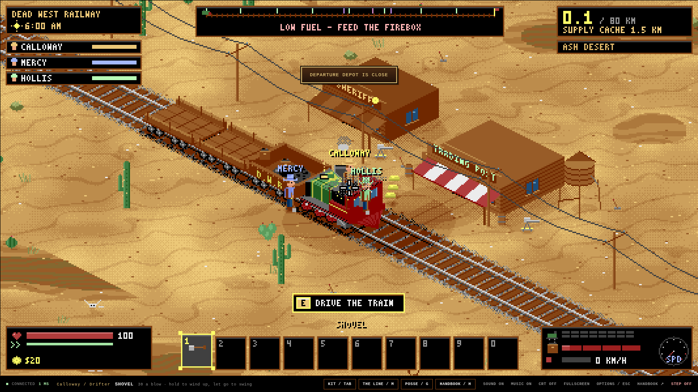

# Dead West Railway

_They laid the line. Now they walk it._



The Dead West Railway Co. buried the men who built its line beneath the track. The dead got up.

Take a steam train east across the quarantined Cinder Territory with up to five friends. Keep the boiler fed, scavenge what you can, and keep each other breathing. It's eighty kilometres to the other side.

A co-op survival game for one to six players on Windows, macOS and Linux. Ride online, with friends on your own network, or alone with no internet at all.

## Download

| System                                           | Download                                                                                                                              |
| ------------------------------------------------ | ------------------------------------------------------------------------------------------------------------------------------------- |
| **Windows** 10 or 11, 64-bit                     | [Dead-West-Railway-Setup.exe](https://github.com/Joshspeakman/dead-west-railway/releases/latest/download/Dead-West-Railway-Setup.exe) |
| **macOS** 12 or newer, Apple Silicon and Intel   | [Dead-West-Railway.dmg](https://github.com/Joshspeakman/dead-west-railway/releases/latest/download/Dead-West-Railway.dmg)             |
| **Linux** 64-bit: Ubuntu, Debian, Mint, Pop!\_OS | [dead-west-railway_amd64.deb](https://github.com/Joshspeakman/dead-west-railway/releases/latest/download/dead-west-railway_amd64.deb) |
| **Linux** 64-bit: any other distribution         | [Dead-West-Railway.AppImage](https://github.com/Joshspeakman/dead-west-railway/releases/latest/download/Dead-West-Railway.AppImage)   |

Every version is on the [releases page](https://github.com/Joshspeakman/dead-west-railway/releases).

No download? The same game runs in a desktop browser at **[dead-west-railway.fly.dev](https://dead-west-railway.fly.dev)**.

## Install

The game isn't signed with a paid publisher certificate yet, so Windows and macOS ask you to confirm the first time you open it. That's expected.

### Windows

1. Run **Dead-West-Railway-Setup.exe**.
2. If Windows shows **"Windows protected your PC"**, click **More info**, then **Run anyway**.
3. The game installs for your user account and opens. It adds itself to the Start menu and the desktop.

To uninstall, go to **Settings → Apps → Installed apps → Dead West Railway → Uninstall**.

### macOS

1. Open **Dead-West-Railway.dmg** and drag **Dead West Railway** into **Applications**.
2. Open it from Applications. macOS will say it can't verify the app. Click **Done** (not Move to Trash).
3. Open **System Settings → Privacy & Security**, scroll down to the message about Dead West Railway, and click **Open Anyway**. Confirm with your password.

You only do this once. On macOS 14 or older you can instead right-click the app, choose **Open**, then **Open** again.

If macOS ever says the app "is damaged", run this in Terminal, then open it again:

```sh
xattr -dr com.apple.quarantine "/Applications/Dead West Railway.app"
```

### Linux

**Ubuntu, Debian, Mint, Pop!\_OS:** install the `.deb` from a terminal in your Downloads folder, then launch **Dead West Railway** from your applications menu:

```sh
sudo apt install ./dead-west-railway_amd64.deb
```

**Other distributions:** make the AppImage executable and run it:

```sh
chmod +x Dead-West-Railway.AppImage
./Dead-West-Railway.AppImage
```

If it won't start, install FUSE 2 (`libfuse2` on most distributions; `libfuse2t64` on Ubuntu 24.04 and later). If it complains about the "SUID sandbox", use the `.deb` instead, or start it with `./Dead-West-Railway.AppImage --no-sandbox`.

## Four ways to ride



The game opens on a launcher:

- **Ride online** puts you on the Dead West Railway server, where friends anywhere can board with you.
- **Host on your network** opens a station on your computer. Friends on the same Wi-Fi or home network board at your station, with no internet needed.
- **Join on your network** lists the stations friends have opened on your network. Click one to board. If yours isn't listed, type the address your friend's lobby shows (for example `192.168.1.20`).
- **Ride alone** plays on your computer only. No internet, no one else.

**← LAUNCHER** in the strip at the bottom of the game takes you back. When you're hosting, that closes your station, so make sure your friends are done first.

### Hosting on your network

- The first time you host, your computer may ask whether Dead West Railway can use the network. On Windows, allow it on **private networks**; on macOS, click **Allow**. Otherwise friends can't reach you.
- Your lobby shows the address friends can type if your station isn't listed for them.
- Stations use **TCP port 7891** for the game, and **UDP port 7892** to tell other launchers they're open. If a firewall blocks 7892, friends can still type your address. If it blocks 7891, nobody can board.
- Whoever hosts runs the game for everyone, so friends play the host's version and don't need the same release.

## Ride together



However you're riding, boarding works the same way:

1. One of you types a name and clicks **Take out a train**. You get a five-character **ticket**, for example `R8Y3C`.
2. Send the ticket to your friends. They type their names, enter it under **Holding someone's ticket?** and click **Board**.
3. Everyone picks who they were, then clicks **Ready**. Whoever took out the train departs when the posse is ready.

Up to six can ride together. Once the train leaves the station nobody new can board, so gather everyone first. If your connection drops, open the game again and board with the same ticket to get back in.

Online, the first ride after a quiet spell takes a few seconds while the server wakes: you'll see **WAKING THE LINE**.



## Controls

Play with a keyboard and mouse.

| Key                | What it does                                               |
| ------------------ | ---------------------------------------------------------- |
| W A S D            | Walk                                                       |
| Mouse, left click  | Aim and shoot. With a melee weapon, hold to wind up        |
| Right mouse (hold) | Aim down the sights                                        |
| Shift              | Sprint                                                     |
| Space              | Roll while moving, hop while standing                      |
| E                  | Use, pick up, buy, take the controls. Hold for longer jobs |
| R                  | Reload                                                     |
| Q                  | Drop                                                       |
| 1–0, mouse wheel   | Choose from your belt                                      |
| Tab                | Your things                                                |
| M                  | The map of the line                                        |
| G                  | Your posse                                                 |
| C (hold)           | Emotes                                                     |
| Enter              | Chat                                                       |
| H                  | The handbook                                               |
| Esc                | Options: volume, fullscreen, screen effects                |
| F11                | Fullscreen                                                 |

The handbook (**H**) covers the rest. Everything else, you'll find out on the line.

## Good to know

- **Your progress** (what you've earned and unlocked) is kept separately online and on your computer. Riding alone and hosting share your computer's progress. Riding online has its own, kept on the server. Playing in a browser counts as a different rider again.
- **Updates:** riding online always uses the newest game. Riding alone and hosting use the game that came with your copy of the app, so download the newest release to get updates there.
- **"Can't be reached" or "no answer"** means the launcher couldn't find that server or station. Check your connection, or the address, and try again.

---

© 2026 Joshspeakman. All rights reserved.
